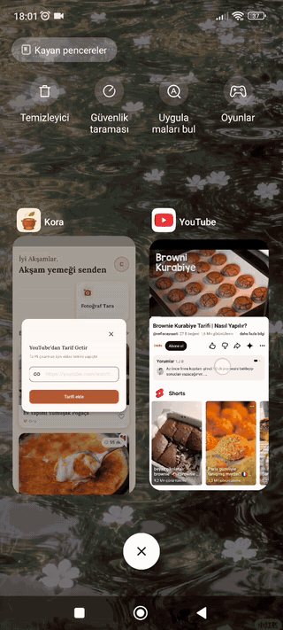
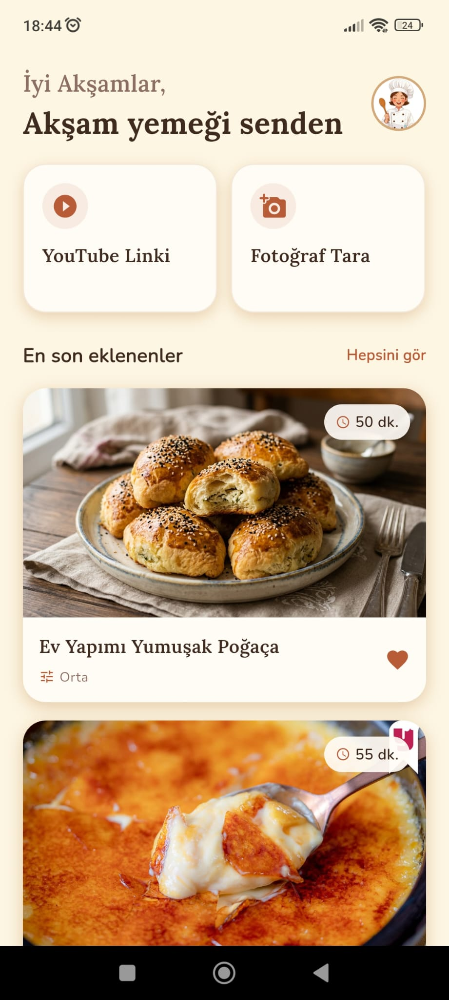
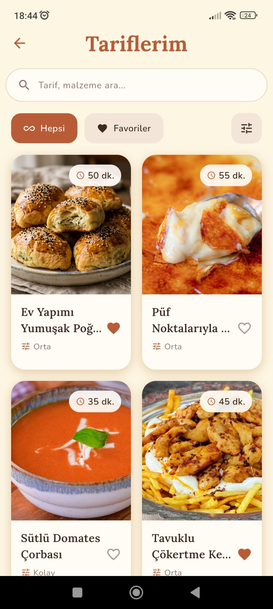
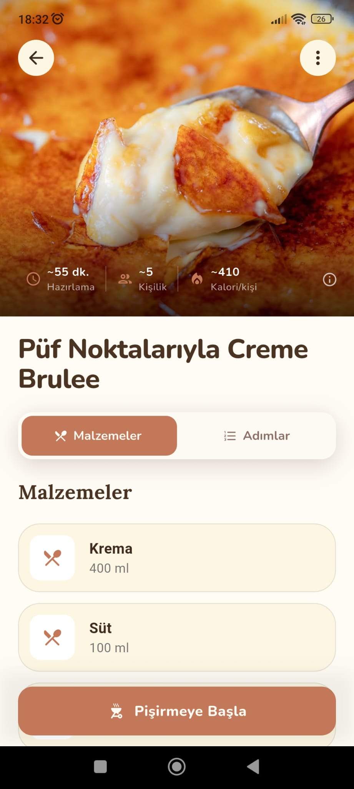
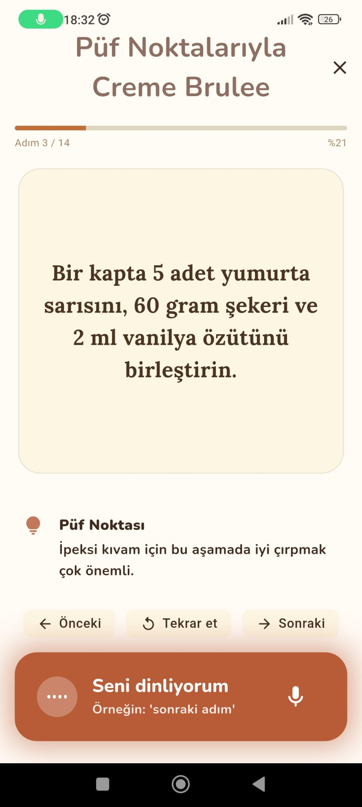
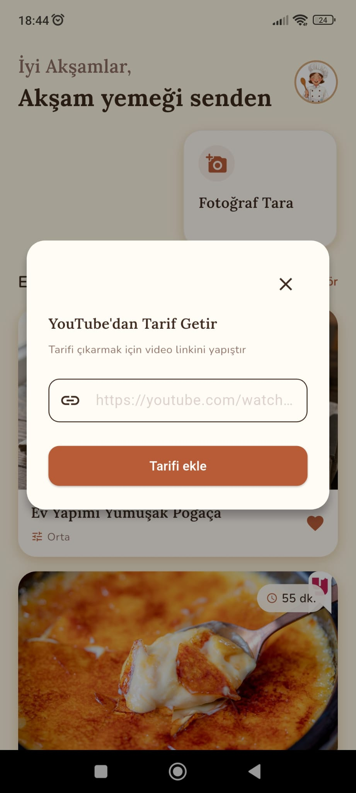
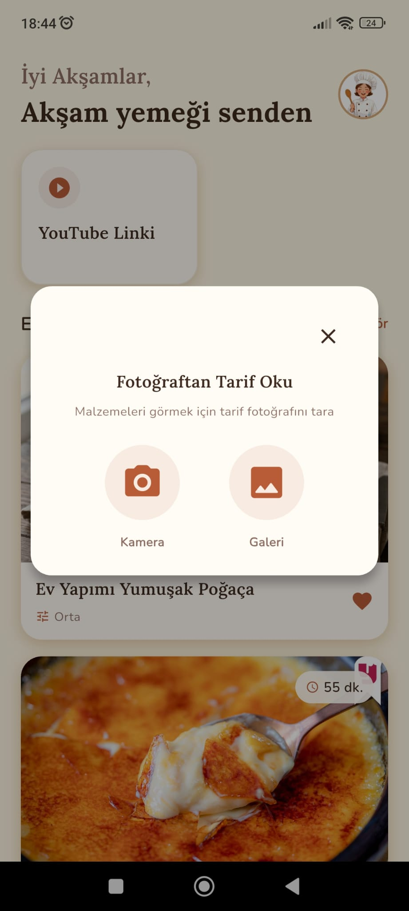
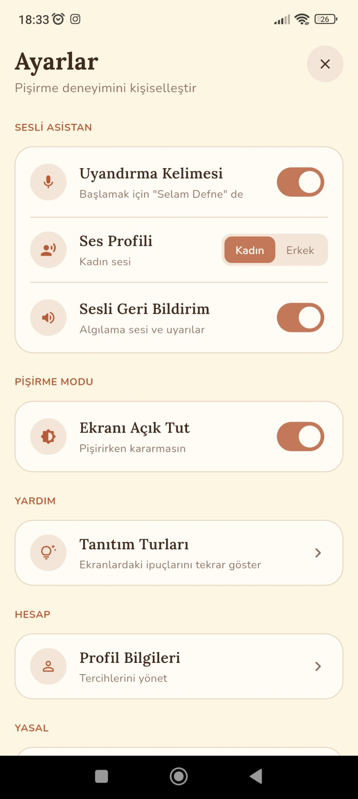

<h1 align="center">Kora</h1>

  <b>AI-powered voice cooking assistant</b> 
  Turn any YouTube recipe video or recipe photo into a step-by-step recipe, then cook hands-free with a Turkish voice assistant.

  Flutter · .NET 8 · Python · Azure &nbsp;|&nbsp; <i>Currently in Google Play closed testing</i>

  

---

## Features

- **Import from YouTube** – Share a recipe video to Kora; AI extracts ingredients and steps as a structured recipe.
- **Import from photos** – Scan a handwritten or printed recipe with the camera or pick it from the gallery.
- **AI-generated recipe images** – Every imported recipe gets a cover image.
- **Hands-free cooking mode** – Say *"Selam Defne"* and move through steps by voice. The assistant reads steps aloud and answers questions in real time.
- **Offline wake word** – Wake word detection runs on the device, without internet.
- **Recipe library** – Search, filter and save favorites.

## Screenshots

| Home | My recipes | Recipe detail | Cooking mode |
|:---:|:---:|:---:|:---:|
|  |  |  |  |

| Import from YouTube | Import from photo | Settings |
|:---:|:---:|:---:|
|  |  |  |

## Tech stack

| Layer | Technologies |
|---|---|
| **Mobile** | Flutter, Dart, BLoC/Cubit, Dio, go_router, get_it/injectable, dartz, flutter_secure_storage, Vosk (on-device wake word), LiveKit client |
| **Backend** | ASP.NET Core 8 Web API, Entity Framework Core, SQL Server, ASP.NET Identity, JWT, Google Sign-In, Swagger |
| **AI** | Google Gemini (recipe extraction from video and photos, image generation), OpenAI GPT-4o-mini |
| **Voice agent** | Python, LiveKit Agents, Deepgram (speech-to-text), ElevenLabs (text-to-speech) |
| **Cloud** | Azure App Service, Azure Blob Storage, Docker |

## Architecture

- **Mobile:** Feature-based Clean Architecture (data / domain / presentation) with BLoC/Cubit for state management and the Either pattern for error handling.
- **Backend:** Layered ASP.NET Core API (API, Business, Core, Infrastructure) with Repository Pattern and Dependency Injection.
- **AI resilience:** Gemini calls use a primary → fallback model chain and retry only on transient errors, so imports keep working during provider outages.
- **Voice:** A Python agent on LiveKit handles real-time speech in Turkish, including text normalization for natural pronunciation of units and fractions.

## Source code

The source code is private because Kora is a product in active development. It can be shared with recruiters and interviewers on request.

## Contact

**Ceyda Palancı** · Flutter Developer
[LinkedIn](https://www.linkedin.com/in/ceyda-palanci-748b8b258/) · ceydapalanci08@gmail.com
